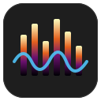
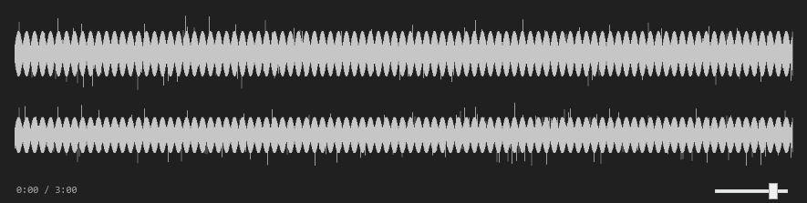

# QuickLook.Plugin.AudioViewer

[](LICENSE)

给 [QuickLook](https://github.com/QL-Win/QuickLook) 用的音频预览插件：按空格预览音频文件，
看到的是一条**整段波形**，铺满窗口，点哪儿就从哪儿播。

支持 `.wav .mp3 .flac .ogg .oga .m4a .aac .wma .aif .aiff`。



## 为什么是重写

这个仓库原本是 [nielsr2/QuickLook.Plugin.AudioViewer](https://github.com/nielsr2/QuickLook.Plugin.AudioViewer)
（MIT）的重写分支。1.x 后来长出了光谱、时间缩放、深度缩放 tile、MIDI 音符层和一套设置面板，
代价是每打开一个文件要完整解码三遍、空闲时也占用约 8% 的单核、播放头每帧重绘整条时间线。

2.0 只保留"看波形、点一下、听"这一件事：代码从 7100 行降到 1700 行，空闲 CPU 归零。

## 功能

- **整段波形**：一通道一行，始终完整适配窗口；窗口变化时按新宽度重新出图。
- **单击跳转播放**：点哪儿从哪儿播。
- **拖动 scrub**：按住期间输出暂停，松手从落点开始播（避免爆音）。
- **音量条**：右下角，与时间码同一行；点击定位、可拖拽，跨预览与跨重启记忆。
- **时间码**：`mm:ss / mm:ss`，超过一小时自动显示小时。
- 跟随 QuickLook 的明暗主题，控件背景透明，使用宿主窗口底色。

| 操作 | 行为 |
| --- | --- |
| 单击波形 | 跳到该处并播放 |
| 拖动波形 | 试听位置；按住时静音，松手从落点播放 |
| `K` | 播放 / 暂停（需要先点一下预览给它焦点） |
| 音量条 | 点击轨道即定位，或拖拽 |

`Space` 和方向键留给 QuickLook 与资源管理器（它们用来开关预览、切换文件），插件不拦截。

## 安装

1. 在资源管理器里对 `QuickLook.Plugin.AudioViewer.qlplugin` 按**空格**。
2. 确认安装提示。
3. 重启 QuickLook。

然后对任意支持的音频文件按空格即可预览。

> 从 1.x 升级：旧插件的配置不会被删除或改写。其中的 `AutoPlay` 仍然生效（只读，没有界面），
> 其它设置不再使用。音量存在同一文件的 `Volume` 键里。

## 构建

需要 [.NET SDK 8](https://dotnet.microsoft.com/download)（.NET Framework 的引用程序集由 NuGet 提供，
不需要装 Visual Studio）。`QuickLook.Common` 是子模块，务必带上：

```
git clone --recurse-submodules https://github.com/<你的账号>/QuickLook-WavePlugin.git
dotnet build QuickLook.Plugin.AudioViewer/QuickLook.Plugin.AudioViewer.csproj -c Release
powershell -File Scripts/pack-zip.ps1
```

产物是 `QuickLook.Plugin.AudioViewer.qlplugin`（一个 zip，DLL 与配置文件在根目录）。

## 测试

```
powershell -File Scripts/test.ps1
```

脚本会先构建，再把测试输出复制到 `%TEMP%` 下执行。这个中转不是多余的：.NET Framework
用 `Assembly.LoadFrom` 解析测试程序集，某些机器/磁盘路径会把它判定为"从网络位置加载"
（HRESULT `0x80131515`），此时 VSTest 会报告找不到测试。多数机器上直接 `dotnet test` 也可以。

## 测量

`tools/WaveformHarness` 是开发用的小工具：在真实 WPF 窗口里打开真实文件，打印各阶段耗时。
它会自己生成测试音频，不需要准备素材：

```
dotnet build tools/WaveformHarness -c Release
WaveformHarness --make-test artifacts/testdata/test-3min.wav 180
WaveformHarness artifacts/testdata/test-3min.wav --play
WaveformHarness artifacts/testdata/test-3min.wav --click        # 点击后的播放头轨迹
WaveformHarness artifacts/testdata/test-3min.wav --screenshot out.png
```

3 分钟 / 44.1 kHz / 立体声 WAV（30 MB）上的参考数字：

```
open reader    : 4 ms
scan (8192 col): 42 ms          分配 0.2 MB
first waveform : 177 ms         冷启动，含 WPF 首次建窗
warm reopen    : 10 ms 出画面 / 26 ms 出完整波形   ← 切下一个文件就是这个数
idle CPU       : 0 %
playhead tick  : 0.02 ms
playback CPU   : 约 3 % 单核
```

## 目录结构

```
QuickLook.Plugin.AudioViewer/      插件本体
  Plugin.cs                        IViewer 入口：支持的后缀、窗口尺寸、创建控件
  WaveformPreviewControl.xaml(.cs) 整个预览：主题、加载、跳转、播放、时钟、卸载
  Controls/WaveformView.cs         把波形数据栅格化成位图并贴出
  Audio/                           解码、峰值扫描、位图栅格化、WASAPI 播放
tests/                             单元测试（xunit）
tools/WaveformHarness/             测量工具，不随插件分发
Scripts/                           打包与测试脚本
QuickLook.Common/                  上游子模块，提供 IViewer / ContextObject 等 API
```

## 改代码前值得知道的三件事

1. **播放头不要用音频位置驱动。** `AudioPlayer.Position` 是读取端的位置，比实际听到的
   超前一个输出缓冲，并且会随设备状态跳变。播放头走的是以最后一次定位为锚点的单调时钟，
   只在偏差超过 0.3 s 时才校正。
2. **可听得到的定位必须经过 `AudioPlayer.SeekAndPlay`。** `WasapiOut` 启动前会预读满整个
   缓冲区，`Pause()` 明确保留缓冲，只有 `Stop()` 会丢弃 —— 否则会听到旧位置的残留音频。
3. **播放器是懒创建的。** 加载时不建播放器，首次播放才建；初始化但从未播放的 WASAPI
   流本身就有 CPU 开销。

更细的维护笔记见 [CLAUDE.md](CLAUDE.md)（英文，写给接手的人或 AI）。

## 兼容性

- QuickLook 4.x。本版本在 **4.5.0**（Microsoft Store 版）上核对过 `IViewer` 与
  `ContextObject` 的接口，并据此编译。
- Windows 10 1903+ / Windows 11，.NET Framework 4.8（系统自带）。
- FLAC / M4A / AAC / WMA 走 Media Foundation 解码。

## 许可

[MIT](LICENSE)。本仓库是 `nielsr2/QuickLook.Plugin.AudioViewer`（MIT）的重写分支，
原始版权声明保留在 [LICENSE](LICENSE) 中。

`QuickLook.Common/` 是上游子模块（MIT），只在构建时引用；插件运行时使用宿主随附的那一份，
仓库与安装包里都不重复分发。第三方组件与许可证全文见 [THIRD-PARTY-NOTICES.md](THIRD-PARTY-NOTICES.md)。
